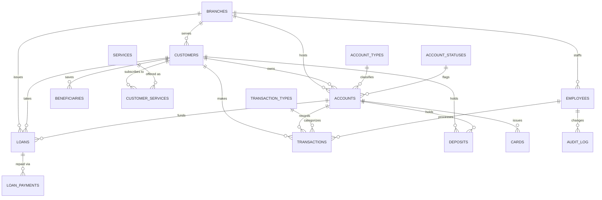

# Bank Management System & Marketing Data Mining

Two related but independent banking exercises in one repository: a
relational **database design** for core banking operations, and a
**data-mining / EDA** project on real bank telemarketing campaign data.

---

## Contents

| Part | What it is | Where |
|---|---|---|
| 1. Bank Management System (BMS) | SQL Server schema + seed data + analytical queries for a retail bank | [`sql/`](sql/) |
| 2. Bank Marketing Campaign Data Mining | EDA, cleaning, and an Orange visual data-mining workflow on real telemarketing outcomes | [`notebooks/`](notebooks/), [`orange/`](orange/), [`data/`](data/) |

These two parts use **different, unrelated datasets** (one synthetic, one
real-world) — see each section below.

---

## Part 1 — Bank Management System (SQL)

A 16-table SQL Server schema modeling a retail bank's core operations:
branches, staff, customers, accounts, transactions, loans, cards, deposits,
services, and an audit trail — plus synthetic seed data and 10 analytical
queries answering realistic banking-operations questions.

### Schema



16 tables: `branches`, `employees`, `customers`, `account_types`,
`account_statuses`, `accounts`, `transaction_types`, `transactions`,
`services`, `customer_services`, `loans`, `loan_payments`, `cards`,
`beneficiaries`, `deposits`, `audit_log`. Indexed on the columns most
queried (`accounts.customer_id`, `transactions.account_id` /
`.customer_id` / `.transaction_date`, `customers.email` / `.phone`).

### Files

| File | Purpose |
|---|---|
| [`sql/01_create_schema.sql`](sql/01_create_schema.sql) | Creates all 16 tables, foreign keys, and indexes |
| [`sql/02_seed_data.sql`](sql/02_seed_data.sql) | Resets and populates every table with synthetic sample data (Egypt-themed branches/customers) |
| [`sql/03_analysis_queries.sql`](sql/03_analysis_queries.sql) | 10 analytical queries/views (see below) |
| [`sql/Bank_Management_System_seed_data_export.xlsx`](sql/Bank_Management_System_seed_data_export.xlsx) | The seed data exported to Excel, one sheet per table, for reviewing without a database connection |

### Analytical Queries (`03_analysis_queries.sql`)

1. **Customer Master View** — total accounts + total balance per customer, top 20 by balance
2. **Account Portfolio View** — account status/balance by branch, inactive/closed accounts by date
3. **Monthly Transaction Summary** — credit/debit/net flow per month, last 12 months
4. **Customer Statement View** — full transaction history for a given customer + date range
5. **Top Customers by Activity** — most active customers (last 90 days), ranked with `ROW_NUMBER()`/`DENSE_RANK()`
6. **Branch Performance View** — customers, transaction volume, and net flow per branch (last 30 days)
7. **Employee Activity Report** — top 10 staff by transactions handled (last 30 days)
8. **Service Adoption & Cross-Sell View** — customers with 2+ active services
9. **Inactive Accounts** — accounts with no activity in 60+ days (operations/risk)
10. **Suspicious Transaction Detection** — rule-based flags: amount > branch mean + 3×stdev, or a debit exceeding 80% of the account balance

### Running It

Requires SQL Server (or Azure SQL). In order:

```sql
-- 1. Create the schema
:r sql/01_create_schema.sql

-- 2. Load seed data
:r sql/02_seed_data.sql

-- 3. Run the analytical queries
:r sql/03_analysis_queries.sql
```

---

## Part 2 — Bank Marketing Campaign Data Mining

EDA and cleaning of a real Portuguese bank's telemarketing campaign data
(predicting whether a client subscribes to a term deposit), followed by a
visual data-mining workflow built in [Orange](https://orangedatamining.com/).

### Dataset

**42,188 rows × 21 columns** — one row per client contact, with
demographic fields (`age`, `job`, `marital`, `education`), financial flags
(`default`, `housing`, `loan`), campaign details (`contact`, `month`,
`day_of_week`, `duration`, `campaign`, `pdays`, `previous`, `poutcome`),
5 macroeconomic indicators (`emp.var.rate`, `cons.price.idx`,
`cons.conf.idx`, `euribor3m`, `nr.employed`), and the target `y`
(subscribed: yes/no). See [`DATA_NOTES.md`](DATA_NOTES.md) for a correction
to the notebooks' own dataset-description text, which doesn't match this
shape.

Target is heavily imbalanced: **88.2% "no" vs 11.8% "yes"** (36,800 / 4,913
after cleaning) — accuracy alone is a misleading metric here (see
Conclusion below).

### Cleaning Pipeline

Applied in [`notebooks/Bank_Marketing_EDA_02_after_cleaning.ipynb`](notebooks/Bank_Marketing_EDA_02_after_cleaning.ipynb):

1. Cast 6 whole-number columns from `float64` to `Int64` (`age`, `duration`, `campaign`, `pdays`, `previous`, `nr.employed`).
2. Missing values (all columns < 0.2% missing): categorical → filled with `"Unknown"`; numeric + target → rows dropped.
3. Dropped 475 duplicate rows.
4. Dropped rows with `duration == 0` (4 rows — call never took place).
5. Encoded the `pdays == 999` sentinel ("never previously contacted") as a binary flag `was_previously_contacted`, since 39,673 of 41,717 rows carry this placeholder and standard statistics on it are meaningless.
6. Capped `campaign` at 10 (raw max was 56 — judged a likely CRM data-entry error). **Note:** the committed `data/BankMarket_cleaned_for_orange.csv` predates this step — see `DATA_NOTES.md` §2.

Result: 42,188 → 41,713 rows.

### Key EDA Findings

- **`duration` is the strongest predictor** of subscription but is only known *after* the call ends — a textbook data-leakage feature, excluded from the "after cleaning" model comparison below.
- **Students (31.4%) and retirees (26.4%)** convert far above average; **blue-collar workers** are the largest group (9,313 contacts) but convert at only 7.2% — the campaign is over-investing in low-return segments.
- **A prior successful campaign (`poutcome = success`) yields 61.6% conversion** — the single strongest categorical predictor found.
- **Severe multicollinearity** among the 3 macroeconomic indicators `euribor3m`, `emp.var.rate`, `nr.employed` (r = 0.90–0.97) — only `euribor3m` is recommended for modeling.
- Chi-square test confirms `job` × `y` is statistically significant (p < 0.05).

### Before/After Cleaning: Model Impact

A baseline Logistic Regression (excluding the leaky `duration`, sentinel
`pdays`, and outlier-heavy `campaign` in both cases) was fit before and
after the full cleaning pipeline, to isolate cleaning's effect on model
performance:

| | Accuracy | R² |
|---|---:|---:|
| Before cleaning | 89.54% | 0.0001 |
| After cleaning | 89.66% | 0.0048 |

The near-identical accuracy is expected and consistent with the notebook's
own conclusion: with an 88/12 class split, a model that always predicts
"no" scores ~88% accuracy for free — **accuracy is not a meaningful metric
for this target**, cleaning notwithstanding. F1-score/recall against the
minority "yes" class (with class weighting or SMOTE) is the documented
recommendation for any real modeling work — see the notebook's Q20
conclusion for the full reasoning.

### Orange Workflow

[`orange/Bank_Marketing_Orange_Workflow.ows`](orange/Bank_Marketing_Orange_Workflow.ows)
is a visual data-mining pipeline (open with [Orange](https://orangedatamining.com/download/),
free) built on [`data/BankMarket_cleaned_for_orange.csv`](data/BankMarket_cleaned_for_orange.csv).
See `DATA_NOTES.md` §2 for the one caveat on this input file's `campaign` column.

### Files

| File | Purpose |
|---|---|
| [`notebooks/Bank_Marketing_EDA_01_before_cleaning.ipynb`](notebooks/Bank_Marketing_EDA_01_before_cleaning.ipynb) | Initial load + baseline model, pre-cleaning |
| [`notebooks/Bank_Marketing_EDA_02_after_cleaning.ipynb`](notebooks/Bank_Marketing_EDA_02_after_cleaning.ipynb) | Full EDA (20 questions: overview → cleaning → univariate → bivariate → multivariate) + before/after model comparison |
| [`data/BankMarket_cleaned_for_orange.csv`](data/BankMarket_cleaned_for_orange.csv) | Cleaned dataset, exported for Orange |
| [`orange/Bank_Marketing_Orange_Workflow.ows`](orange/Bank_Marketing_Orange_Workflow.ows) | Orange visual data-mining workflow |

---

## Reports

- [`reports/Final_Report_Data_Mining.pdf`](reports/Final_Report_Data_Mining.pdf) — full written report for the Data Mining course submission.

## Team

Marwa, Radwa, Basma, Yomna.

## Data Notes

See [`DATA_NOTES.md`](DATA_NOTES.md) for two discrepancies found while
organizing this repository (a copy-pasted dataset description that doesn't
match the real data, and a stale exported CSV) — recorded so the numbers
above can be traced back to their source.

## License

No license has been specified for this project. All rights reserved by the
author(s) unless a `LICENSE` file is added.
